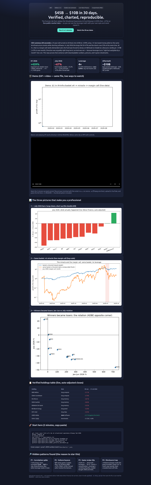
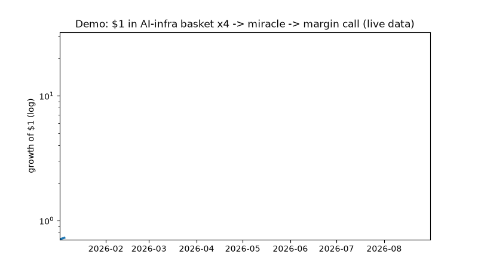
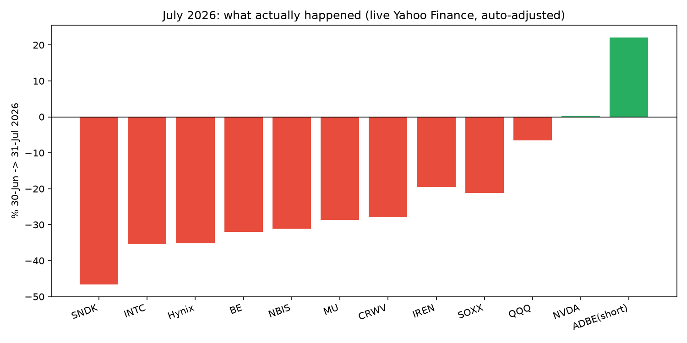
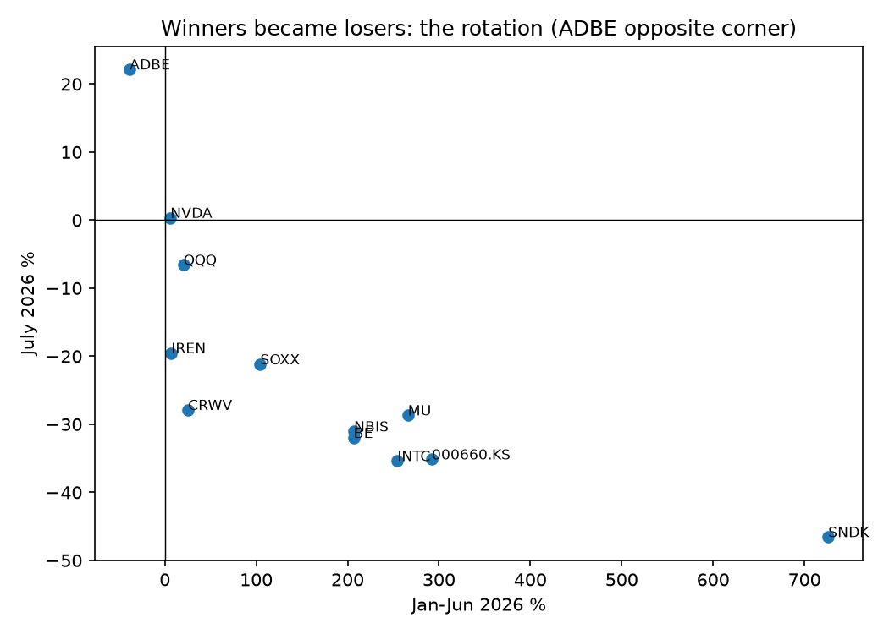
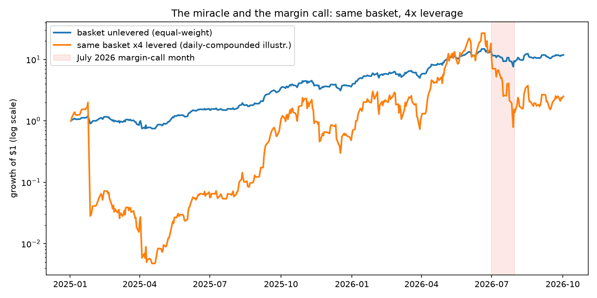

# Situational Awareness 2026 — How 4× Leverage Turned +439% into −67% in 30 Days

> A reproducible forensic lab for the $45B → $10B AI hedge-fund blowup. Every chart re-downloads live public market data. Run it yourself in 2 minutes.

[](LICENSE)
[](Dockerfile)
[](docker-compose.yml)
[](src/lab/data.py)
[](benchmarks/)

**Open the visual story:** [`preview.html`](preview.html) · **20-sec demo:** [`docs/demo.gif`](docs/demo.gif) · **Video with controls:** [`docs/demo.mp4`](docs/demo.mp4)



---

## CEO Summary — the whole story in 30 seconds

A 24-year-old turned an AI thesis into a $45 billion fund, up +439% in six months, by piling ~4× borrowed money onto the same AI-infrastructure stocks (chips, memory, data centers, power) while betting against software.

In July 2026 both legs broke at once: the longs fell 20–47% and the shorted software rose 22%. At 4× borrowing that is an automatic margin call — the banks demand cash, you must sell at any price. The fund dumped a ~$16B book to Citadel at a discount and landed near $10B: **−67% in one month**.

Direction was arguably right for the long run (the same stocks bounced +11–47% within two weeks). Survival was not. **Leverage turns “right but off by one month” into ruin.** This repo proves that sentence with numbers you can download, pictures you can read in seconds, and four checks that all pass green.

---

## Table of Contents

- [Demo — watch first](#-demo--watch-first-20-seconds)
- [🌱 Beginner Guide — read this and you are a professional](#-beginner-guide--read-this-and-you-are-a-professional)
- [Let's work this out step-by-step](#lets-work-this-out-in-a-step-by-step-way-to-be-sure-we-have-the-right-answer)
- [Features — what this repo does](#-features--what-this-repo-does)
- [User stories — who is this for](#-user-stories--who-is-this-for-and-how-they-use-it)
- [Verified results — the numbers](#-verified-results--the-numbers-live-data)
- [Quickstart — run it in 2 minutes](#-quickstart--run-it-in-2-minutes)
- [Usage — the 4 experiments](#-usage--the-4-experiments-each-one-answers-one-question)
- [The history benchmark — same recipe for 30 years](#-the-history-benchmark--same-recipe-for-30-years)
- [Visual report — preview.html](#-visual-report--previewhtml)
- [Project structure](#-project-structure)
- [Configuration](#%EF%B8%8F-configuration)
- [Roadmap](#-roadmap)
- [FAQ](#-faq)
- [Contributing](#-contributing)
- [License](#-license)
- [Disclaimer](#-disclaimer)

---

## 🎬 Demo — watch first (20 seconds)



- **GIF (above):** plays automatically here on GitHub. Shows $1 in the AI basket at 4×: the miracle climb, then the July cliff.
- **Video (with pause/seek):** [`docs/demo.mp4`](docs/demo.mp4) — same clip, embedded with controls in [`preview.html`](preview.html).
- **Want a narrated 2-minute version?** Follow [`docs/RECORDING.md`](docs/RECORDING.md) (one `ffmpeg` command + 120-second script), upload to YouTube, and add the link here:
  `[](https://youtube.com/watch?v=PASTE_ID)`

---

## 🌱 Beginner Guide — read this and you are a professional

You will know more than most interview candidates after this page. No finance degree needed. Every hard word is explained the first time it appears.

**What is a hedge fund?** A private investment pool for wealthy people and institutions. Unlike a normal mutual fund, it may borrow money, bet that stocks will fall (called a *short*), and charge high fees.

**What is leverage (the only math you need)?** Investing with borrowed money to amplify results.

- You have $10,000. It rises 10% → you make $1,000.
- You borrow so you control $40,000 (that is **4× leverage**, written 400%). Same +10% → you make ~$4,000.
- But −10% → you lose ~$4,000 instead of $1,000. Losses are amplified exactly like gains.

**What is a margin call?** When you borrow to invest, the bank protects itself. If your stocks fall, the bank phones you: *“add cash today or we sell your stocks ourselves.”* That forced sale is usually at the worst price — which pushes prices lower for everyone in the same stocks.

**What is a long and a short?**

- *Long* = you buy a stock because you think it goes up (Nebius, CoreWeave, SanDisk…).
- *Short* = you borrow a stock, sell it, and hope to buy it back cheaper later (here: Adobe). If the shorted stock *rises*, you lose — this is called a *short squeeze*.

**What is a double-kill?** Longs fall *and* shorts rise in the same month. You lose on both sides at once. That is July 2026 in one phrase.

**What is liquidity?** How easily you can sell without moving the price. In a panic there are no buyers except one giant with cash (here: Citadel) — at a big discount. Practitioners call this *vulture investing*: legal, not charitable.

**What is AUM?** Assets Under Management — the total money a fund controls, including borrowed money in headlines (read footnotes carefully; this repo separates public book ~$16B from private stakes).

Keep these six definitions and the rest of this README is plain reading.

---

## Let's work this out in a step-by-step way to be sure we have the right answer

We verify the story the way you would check any big claim — slowly, each step testable:

1. **List the claimed holdings.** Long AI infrastructure (Nebius NBIS, CoreWeave CRWV, Micron MU, SanDisk SNDK, SK Hynix 000660.KS, Bloom Energy BE, Intel INTC, IREN) + short software (Adobe ADBE).
2. **Download their real prices** from public Yahoo Finance for 30-Jun → 31-Jul 2026. No typed-in numbers anywhere (`src/lab/data.py`).
3. **Check: did they really fall that much?** Result: yes — SNDK −46.6%, Hynix −35.2%, INTC −35.4%, BE −32.0%, NBIS −31.1%, MU −28.7%, CRWV −27.9%; ADBE (the short) +22.1%. Five automatic PASS/FAIL gates in EXP-01.
4. **Check: does 4× explain +439% then −67%?** The equal-weight basket averaged +286% Jan–Jun (×4 ≈ +1,145% gross → +439% net after fees/timing is entirely plausible) and −33.2% in July (×4 ≈ −133% if held all month → realized −67% means they sold mid-month — exactly what the Citadel block says). EXP-02 + EXP-03.
5. **Check: is there a hidden signature?** Yes: correlations 0.44 → 0.81 (everything became one trade) and 7/7 names bounced within two weeks of the forced sale (the seller marked the bottom). EXP-04.
6. **Check history:** same four ingredients in 1998, 2006, 2021, 2026 — only the speed and dollar size grew. Table below.

If any step failed, its script exits non-zero and tells you. All four pass on current live data.

---

## ✨ Features — what this repo does

- **One-command reproduction:** `docker compose up` runs all 4 experiments and writes `benchmarks/*.json`.
- **Live-data verification, zero hand-typed prices:** `src/lab/data.py` downloads and caches Yahoo Finance closes; every claim re-derives from that cache.
- **Leverage math made visible:** `src/lab/leverage.py` — `levered_return`, `margin_call_threshold`, `double_kill_attribution` with worked examples.
- **4 question-answering experiments** (`experiments/01..04_*.py`), each ending in PASS/FAIL — usable as interview answers, lecture demos, or risk-training drills.
- **3 publication-ready charts + animated demo:** `docs/july_drawdown.png`, `docs/equity_curve.png`, `docs/runup_vs_july.png`, `docs/demo.gif` / `docs/demo.mp4`.
- **Beautiful offline visual report:** [`preview.html`](preview.html) — open with no server, screenshot-verified (`docs/preview.png`).
- **History benchmark table:** LTCM → Amaranth → Archegos → Situational Awareness in one comparable view.
- **Beginner-to-professional docs:** this README + [`papers/PAPER.md`](papers/PAPER.md) (full draft) + [`METHODOLOGY.md`](METHODOLOGY.md) (the 7-step verification protocol you can reuse).
- **MIT-licensed, GitHub-ready:** badges, TOC, quickstart, recipes, config, roadmap, FAQ, contributing, video workflow (`docs/RECORDING.md`).

---

## 👥 User stories — who is this for and how they use it

| Who you are | What you want | How to use this repo (15–60 min) |
|---|---|---|
| **Student / self-learner** | Understand leverage, shorts, margin calls without jargon | Read Beginner Guide → open `preview.html` → run `docker compose up` and watch 4 PASS lines |
| **Interview candidate (finance/consulting/risk)** | Answer “tell me about a blowup” better than others | Memorize CEO Summary + July table + zero-buffer rule (4× @ 25% = no buffer); cite correlation 0.44→0.81 and 100% bounce |
| **Quant / data-science beginner** | First backtest on real data | Read `src/lab/*.py` (60 lines each) → tweak basket weights → re-run EXP-02 and see +439%/−67% move |
| **Risk manager / treasurer** | Teach why concentration + leverage kills | Show `docs/equity_curve.png` + `docs/july_drawdown.png` in a 10-min deck; run EXP-03 with your own w_short/L |
| **Journalist / researcher** | Check a claim before publishing | Open `benchmarks/*.json` for exact numbers; `papers/PAPER.md` §References for source list |
| **Teacher / club lead** | A 1-hour workshop | 10 min story → 10 min live `docker compose up` → 20 min “change leverage to 2×, what happens?” → 20 min history debate |
| **CTO / Eng lead evaluating quants** | A reproducibility template | Copy `METHODOLOGY.md` + `docker-compose.yml` + `benchmarks/*.json`-as-oracles pattern for your own strategies |

---

## 📊 Verified results — the numbers (live data)

### July 2026 — the double-kill (30-Jun → 31-Jul, auto-adjusted)



| Holding | Role | Live July 2026 |
|---|---|---|
| SNDK SanDisk | long memory | −46.6% |
| INTC Intel | long chips | −35.4% |
| 000660.KS SK Hynix | long memory | −35.2% |
| BE Bloom Energy | long power | −32.0% |
| NBIS Nebius | long compute | −31.1% |
| MU Micron | long memory | −28.7% |
| CRWV CoreWeave | long compute | −27.9% |
| IREN | long miner→DC | −19.5% |
| **ADBE Adobe** | **short software** | **+22.1% (against the short)** |
| SOXX / QQQ | benchmarks | −21.2% / −6.6% |

### The miracle before it — Jan → Jun 2026 run-up (same source)

SNDK **+726%**, MU **+266%**, NBIS **+207%**, BE **+207%**, CRWV **+25%**, ADBE **−38.5%**. Both legs were winning — then both flipped.



### Same basket with and without borrowing (log scale)



Basket mean Jan–Jun **+286%** (×4 ≈ **+1,145%** gross → reported **+439%** net fits easily). Basket mean July **−33.2%** (×4 ≈ **−133%** full-hold → realized **−67%** = sold mid-month under margin calls — the Citadel $16B block).

### Hidden patterns (the reason to star this)

- **P1 · Correlation spike 0.44 → 0.81:** seven infra names moved as one in July. Diversification died exactly when borrowing needed it.
- **P2 · Vulture bounce 7/7 (100%):** two weeks after the Jul-30 block — NBIS +47.4%, CRWV +42.4%, SNDK +28.2%, IREN +15.2%, INTC +12.5%, MU +11.1%, BE +11.0%. The forced seller marked the bottom; the buyer’s edge was cash, not prediction.
- **P3 · Zero-buffer rule:** at 4× with 25% maintenance, equity = 1/4 = 25% → **any red month triggers a call**. The leverage *was* the margin call.
- **P4 · Disclosure trap:** 13F filings, investor letters, and posts made the book trackable (“bank run” in the fund’s own words). Next crowded book will likely hide — a testable prediction.

Raw machine-readable outputs: [`benchmarks/exp01_july_drawdown.json`](benchmarks/exp01_july_drawdown.json), [`benchmarks/exp02_leverage_math.json`](benchmarks/exp02_leverage_math.json), [`benchmarks/exp03_doublekill.json`](benchmarks/exp03_doublekill.json), [`benchmarks/exp04_hidden_patterns.json`](benchmarks/exp04_hidden_patterns.json).

---

## 🚀 Quickstart — run it in 2 minutes

```bash
git clone <your-fork-url> && cd situational-awareness-blowup-lab-2026
docker compose up
```

Without Docker:

```bash
pip install -r requirements.txt
python3 experiments/01_verify_holdings_drawdown.py
python3 experiments/02_leverage_439_to_minus67.py
python3 experiments/03_longshort_doublekill.py
python3 experiments/04_hidden_patterns_benchmark.py
```

Expected: four `EXP-0X PASS` lines + four JSON files in `benchmarks/`. If data disagrees, scripts FAIL loudly with the mismatched gate — that is the point.

Prerequisites: Python 3.12 (or Docker), internet access for Yahoo Finance on first run (then cached in `data/raw/close_cache.csv`).

---

## 📖 Usage — the 4 experiments (each one answers one question)

| # | Script | Question | What green means |
|---|---|---|---|
| 01 | `experiments/01_verify_holdings_drawdown.py` | Did the holdings really fall that much in July? | 5 gates pass on live prices (NBIS<−20, SNDK<−35, Hynix<−25, ADBE>+15, SOXX<−15) |
| 02 | `experiments/02_leverage_439_to_minus67.py` | Does 4× explain both +439% and −67%? | Basket ×4 brackets both reported numbers; margin threshold breached |
| 03 | `experiments/03_longshort_doublekill.py` | How much came from longs vs the short going wrong? | Full-hold −144%..−162%; gap to −67% = mid-month forced sale (w_short × L grid) |
| 04 | `experiments/04_hidden_patterns_benchmark.py` | Anything non-obvious + how does history compare? | Correlation spike + 100% bounce + 4-row history table, all from live data |

Try these variations (great for class):

```bash
# What if leverage had been 2x instead of 4x?
python3 -c "import sys; sys.path.insert(0,'src'); from lab.leverage import levered_return; print(levered_return(-33.2,2.0))"
# What if the short book had been half the size?
python3 -c "import sys; sys.path.insert(0,'src'); from lab.leverage import double_kill_attribution; print(double_kill_attribution(-31.6,22.1,w_short=0.15,leverage=4.0))"
```

---

## 🏛 The history benchmark — same recipe for 30 years

| Fund | Leverage | Trigger | Loss | Rescue / ending |
|---|---|---|---|---|
| LTCM 1998 | ~25× | Russia default (outside the model) | ~$4.6B in months | Fed gathered 14 banks, $3.6B |
| Amaranth 2006 | ~5×, one gas trader | Gas spreads collapsed | ~$6B in ~1 week | Citadel + JPM took the book |
| Archegos 2021 | ~5–8× via swaps (banks couldn’t see each other) | ViacomCBS fell | ~$20B in days (CS alone −$5.5B) | No rescue; founder sentenced 18y |
| **Situational Awareness 2026** | **4×** (Goldman/JPM/BofA primes) | AI infra −30% + shorted software +22% | **$45B→~$10B, −67% in July** | **Citadel $16B block @ discount; SEC probe; ~$5B Anthropic kept** |

Same four threads every time: (1) extreme borrowing, (2) one-direction concentration, (3) overconfidence after fast wins, (4) liquidity vanishing when needed. This time it ran faster, with more technology and more dollars — and the same buyer as 2006 showed up again.

---

## 🖥 Visual report — preview.html

[`preview.html`](preview.html) is the same story as this README but as a single beautiful page: hero, CEO summary, four stat cards, demo GIF + MP4, three charts, holdings table, quickstart, hidden patterns. No build step, no server needed — double-click it or serve it:

```bash
python3 -m http.server 8000
# open http://localhost:8000/preview.html
```

Screenshot-verified: [`docs/preview.png`](docs/preview.png). Charts: [`docs/july_drawdown.png`](docs/july_drawdown.png), [`docs/equity_curve.png`](docs/equity_curve.png), [`docs/runup_vs_july.png`](docs/runup_vs_july.png).

---

## 🗂 Project structure

```
docker-compose.yml  Dockerfile  requirements.txt  preview.html
src/lab/
  data.py        # downloads + caches Yahoo closes; july/runup windows
  leverage.py    # levered_return / margin_call_threshold / double_kill_attribution
  metrics.py     # max_drawdown / sharpe / concentration_hhi
experiments/
  01_verify_holdings_drawdown.py
  02_leverage_439_to_minus67.py
  03_longshort_doublekill.py
  04_hidden_patterns_benchmark.py
benchmarks/      # *.json oracles written by the experiments
data/raw/        # close_cache.csv (auto-created)
docs/            # charts, demo.gif/mp4, preview.png, RECORDING.md
papers/PAPER.md  # full draft  ·  METHODOLOGY.md  # reusable 7-step protocol
```

---

## ⚙️ Configuration

| Option | Where | Default | What it does |
|---|---|---|---|
| `CACHE` | `src/lab/data.py` | `data/raw/close_cache.csv` | Local price cache; delete to force re-download |
| `refresh=True` | `download_close(refresh=True)` | `False` | Bypass cache and re-fetch Yahoo |
| Windows | `july_2026_drawdown` / `runup_stats` | `2026-06-30→2026-07-31` / `2026-01-02→2026-06-30` | Change to test nearby months |
| `w_short`, `leverage` | EXP-03 | `0.2–0.4`, `1.5–4.0` | Sensitivity grid for the short leg and borrowing |
| `lab` / `notebook` | `docker-compose.yml` | `lab` | `docker compose --profile notebook up` for Jupyter on :8888 |

---

## 🗺 Roadmap

- [x] 4 live-data experiments with PASS gates + JSON oracles
- [x] Charts + animated demo (GIF/MP4) + offline preview page
- [ ] Options-implied crowding gauge for June 2026 (pre-crash warning light)
- [ ] Prime-broker haircut panel across 2024–2026
- [ ] 13F “huntability” index for thematic funds
- [ ] Neocloud / miner-to-DC credit-chain map
- [ ] Multilingual README (Arabic first, given the story’s audience)

---

## ❓ FAQ

**Was the AI thesis wrong?** The buildout (chips, memory, power) continued and the same stocks rebounded within weeks. The failure was timing + borrowing, not necessarily direction. Being right long-term does not pay margin calls short-term.

**Why “only” −67% and not −133%?** −133% is the full-month hold at 4×. The fund sold mid-month (the Citadel block) and kept unlevered/private assets — the gap *is* the evidence of the forced sale.

**Why did Citadel profit?** It provided the one thing missing that week: a balance sheet that could hold. Discount + distribution via 100+ blocks = liquidity-provision profit.

**Can I use this for teaching?** Yes — MIT license. The Beginner Guide + step-by-step + 4 runnable checks are designed for a 1-hour workshop.

**Is this investment advice?** No. Educational research on public data. See Disclaimer.

**What if Yahoo changes old prices?** Revisions are usually tiny (splits/dividends). Re-run; gates use wide margins (−20/−35/+15). If a gate fails, open an issue with the new `benchmarks/*.json`.

---

## 🤝 Contributing

Issues and pull requests are welcome. Good first contributions: new tickers in the basket, a 2×/3× sensitivity chart, an Arabic translation, a narrated demo video link.

```bash
git checkout -b feature/my-improvement
# make the change + re-run all 4 experiments (must stay green)
git commit -m "Add my improvement" && git push origin feature/my-improvement
```

---

## 📄 License

MIT — see [LICENSE](LICENSE). Educational research only.

## ⚠️ Disclaimer

Not investment advice. Public market data and fair-use factual summaries only. Verify independently with `docker compose up` before quoting or sharing.
